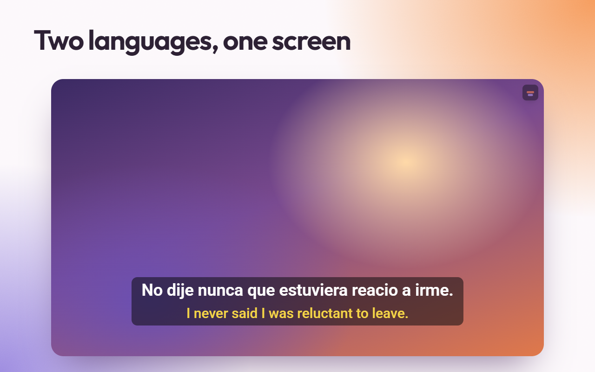
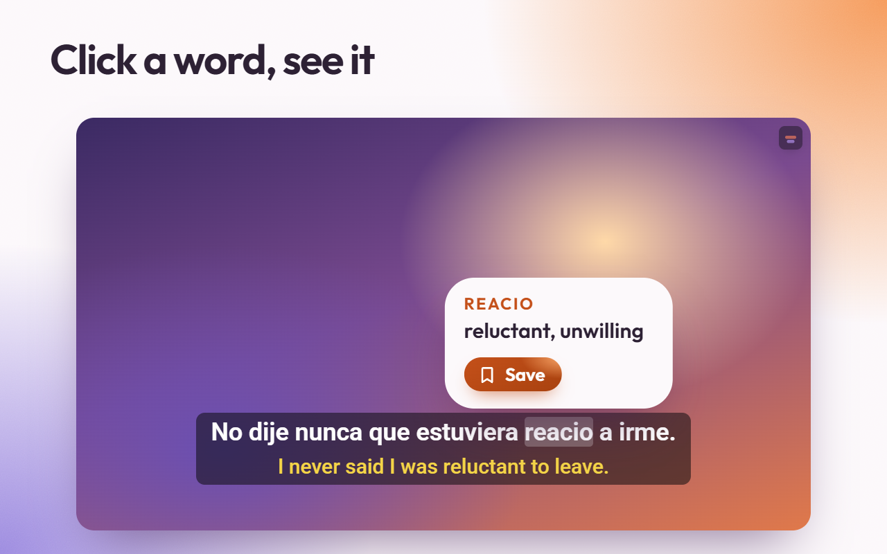
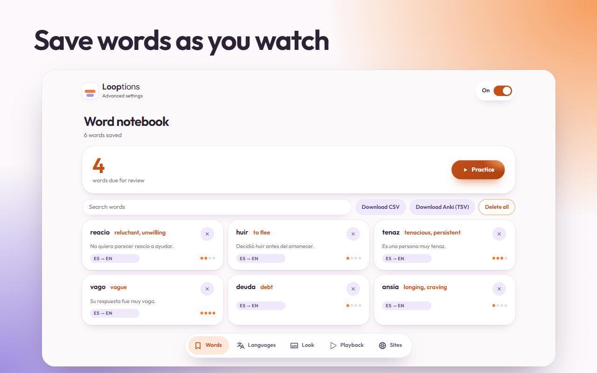
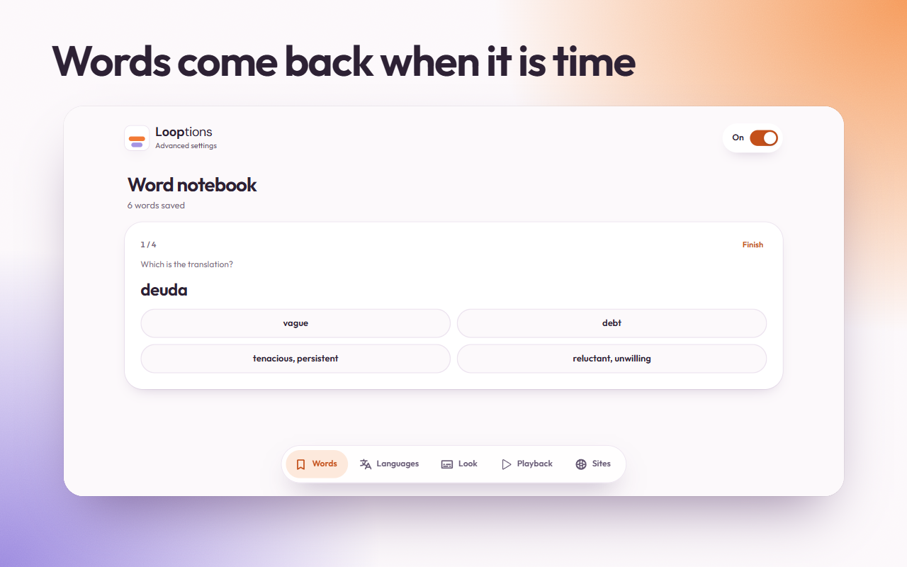
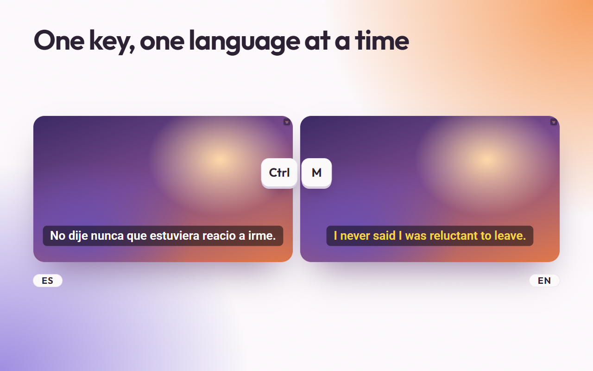
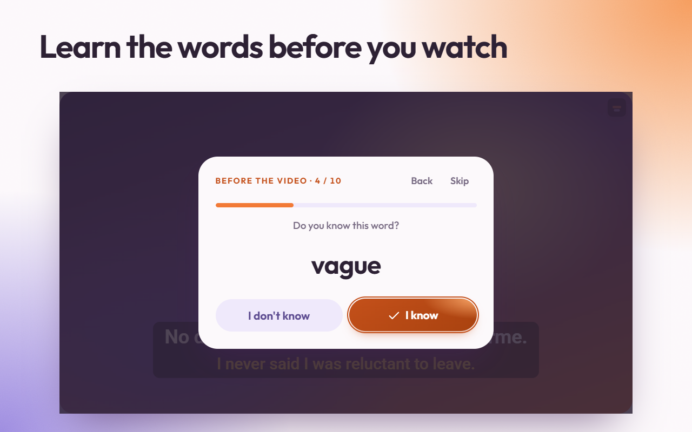
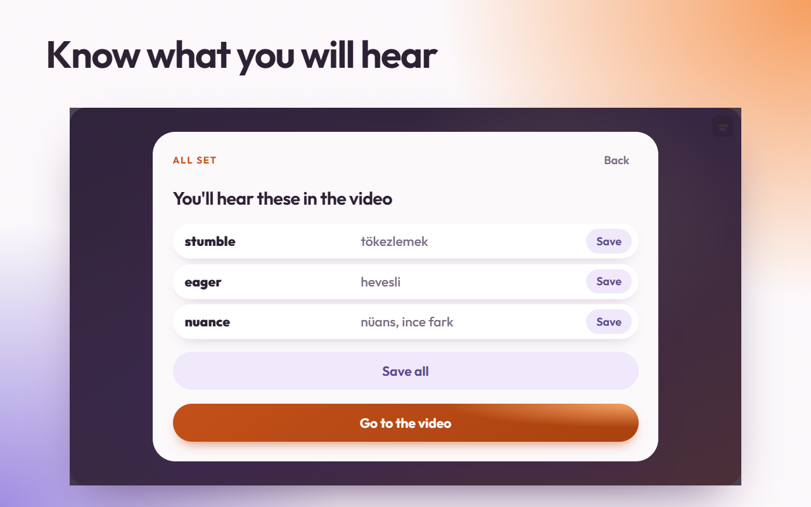

<div align="center">
  

  # Looptions

  **Watch in the language you are learning. Keep your own language one line below.**

  [](manifest.json)
  [](CLAUDE.md)
  [](test)
  [](docs/privacy.html)

  [Why Looptions](#why-looptions) · [Features](#features) · [Shortcuts](#shortcuts) · [How it works](#how-it-works) · [Install](#install) · [Privacy](#privacy-and-data) · [Development](#development)
</div>

Looptions is a Chrome extension that finds the subtitles a video player has already loaded and shows two languages over the video at the same time. The language you are learning sits at the bottom in white, your own language above it in yellow. Click a word you do not know and the video pauses with a translation; save it and practice it later with spaced repetition. The player's own subtitles are hidden, so only one layout stays on screen.

<div align="center">
  
  
  <br>
  
  
  <br>
  
  
  <br>
  
</div>

## Why Looptions

- **It reads the player, not the site.** Looptions picks up `<track>` elements, `.vtt` and `.srt` requests, HLS playlists, and the JW Player, Video.js and Playerjs objects. That covers most streaming sites and players inside iframes. YouTube and Netflix have their own paths.
- **Both lines change together.** Two subtitle files split sentences in different places, so the lines change at different moments and your eyes keep jumping. Looptions ties the second line to the timing of the first. On a real YouTube video, moments where only one line changed dropped by 82%.
- **It teaches the words before the video starts.** You pick your level (A1-C2) during setup or find it with a 20-word test. When an English video opens, Looptions asks about 10 words from that video that sit above your level, then lists the Turkish meanings of the ones you missed. The word list comes from the CEFR-J profile and difficulty is ranked by OpenSubtitles frequency.
- **What you watch becomes study material.** Every saved word keeps the sentence it appeared in, comes back after 1, 3, 7 and 21 days, and exports to CSV or Anki.
- **Keys built for working line by line.** Go to the previous line, repeat the line, go to the next one, or pause at the end of every line. Speed and seek keys are yours to assign.
- **No account, no ads, no telemetry.** Settings and the word notebook stay in your browser. The only thing that leaves is the word you click, with its language pair.

## Features

- 🈯 **Two languages, two modes.** In *both together* mode the two lines are stacked. In *key switch* mode one line shows and `Ctrl+M` swaps the language.
- 🌍 **Six languages, any pair.** Turkish, English, Spanish, Russian, German and French. The interface opens in your own language.
- 👆 **Click, translate, save.** Clicking a word pauses the video and shows the translation above the subtitles. The direction runs from the language of the clicked line to the other one. Pairs that include English also get a dictionary entry.
- 🧠 **Word quiz before the video.** Works for the English → Turkish pair and opens in the first minute of the video. It does not grade you; it shows what you missed. A word is never asked twice. `Skip` or `Esc` leaves at any time. It is off by default and can be turned on in setup or in the popup.
- 📚 **Word notebook and practice.** Due words (up to 15) are asked in three formats: pick the meaning, fill the blank in the saved sentence, or flip a card. A right answer moves the word up one box, a wrong one sends it back to tomorrow.
- ⏯️ **Playback control.** Line skip and repeat, pause at the end of a line, speed up and down (step from 0.05 to 1, range 0.25-4×), and seeking from 1 to 60 seconds. Each key shows a short notice over the video.
- 🎨 **Subtitle appearance.** Five styles (Standard, Cinema, Outline, Line boxes, Minimal), six fonts (Roboto, System, Inter, DM Sans, Nunito Sans, Atkinson Hyperlegible Next), size, background opacity and height. Fonts ship with the extension, including Turkish letters.
- 🎛️ **In-player menu.** Click the small logo in a corner of the video to change style, font, size and timing without leaving the video. The corner is configurable and the logo can be turned off.
- 🌐 **Per-site settings.** Turn the extension, or only the word quiz, off on any site. The settings page lists the sites where Looptions has run, with their logos.
- 🔔 **Missing subtitle notice.** If the language you chose has no subtitles, a short notice says so. On YouTube the platform's own automatic translation is used.

## Shortcuts

| Default | Action |
| --- | --- |
| `Ctrl+M` | Swap the language in key switch mode |
| `Alt+Z` / `Alt+X` / `Alt+C` | Previous line / repeat the line (plays if paused) / next line |
| `Alt+V` | Turn pause at the end of each line on or off (the line stays on screen) |
| Unassigned | Speed up / slow down, seek back / forward |

Every key can be changed under **Advanced settings → Playback**. Line keys must include Ctrl, Alt or Meta. Speed and seek keys can be a single key and never fire while you type in a field (input, textarea, contenteditable, IME). The swap key is set in the popup or during first setup.

## How it works

Looptions does not download or store subtitles. It catches what the page already sent to your browser, parses it, and draws it in an overlay inside a closed shadow root.

| Source | Where |
| --- | --- |
| `<track>` elements, `video.textTracks` | [`src/content/content.js`](src/content/content.js) |
| `.vtt` / `.srt` requests (iframes included) | [`src/background.js`](src/background.js), `webRequest` |
| Subtitles in an HLS master playlist (`EXT-X-MEDIA TYPE=SUBTITLES`) | `src/background.js` + [`src/core/hls.js`](src/core/hls.js) |
| Subtitle bodies from extensionless URLs (`fetch` / XHR) | [`src/inject/main-world.js`](src/inject/main-world.js) |
| JW Player, Video.js and Playerjs objects | `src/inject/main-world.js` |
| YouTube (the player's own timedtext request and `tlang` translation) | `src/inject/main-world.js` |
| Netflix (`timedtexttracks` in the manifest, WebVTT/IMSC) | `src/inject/main-world.js` |

Supported formats are SRT, WebVTT, TTML/IMSC/DFXP and YouTube json3. Turkish SRT files are tried as UTF-8 first, then windows-1254. When a file does not declare its language, it is guessed from the most frequent words in the text. Words are split with `Intl.Segmenter` as they are drawn; the subtitle file itself is not changed.

Word translations come from our own server (a Cloudflare Worker calling Microsoft Translator). If the server does not answer or the monthly quota runs out, the translation box shows a message and the rest of the extension keeps working.

## Install

1. Open `chrome://extensions` and turn on **Developer mode**.
2. Choose **Load unpacked** and select this folder.
3. In the setup page, pick your languages and level, then open a video with subtitles.

There is no build step and no package manager. Chrome 111 or newer is required. The Store package is built with `node scripts/pack.js` into `dist/`; `scripts/check-release.js` runs first.

## Privacy and data

| Data | Where it lives | Does it leave the device? |
| --- | --- | --- |
| Preferences (languages, style, keys, level, site list) | `chrome.storage.sync` | Only through Chrome's own sync, if you are signed in to Google |
| Saved words, practice progress, quiz answers | `chrome.storage.local` | No |
| Domains where the extension ran (up to 50) | `chrome.storage.local`, removable from the Sites page | No. Logos are read from Chrome's icon cache |
| Subtitle files, page and video URLs | In memory only | No |
| The clicked word (and up to ~20 words from the quiz summary) with its language pair | Translation server → Microsoft Translator | **Yes, the word and language pair only.** The page address, video title and any identifier are not sent. The server keeps no word or IP log; the cache holds only (word, language pair, translation). Hosting providers may keep their own infrastructure logs |

Data is not sold and is not used for anything beyond translation. There is no remote code; everything ships in the package. Uninstalling removes local data, and the word notebook supports single and bulk delete. Looptions does not decrypt DRM-protected content, and each site's own terms of use remain the user's responsibility. Full text, in Turkish and English and including the KVKK notice: [`docs/privacy.html`](docs/privacy.html).

## Known limits

- Word translation has no context and does not find the root of a word ("running" does not become "run").
- Burned-in (hardsub) subtitles and encrypted or custom-format subtitles (AES, base64 JSON and similar) are not read.
- Nothing can be drawn over a `<video>` element that itself goes fullscreen. Players that fullscreen a wrapper work fine.
- On live HLS streams only the segments listed at that moment are read.
- YouTube: the `tlang` translation is temporarily blocked with HTTP 429 after many requests, and the extension retries after 15 s, 1 min and 3 min. If captions do not turn on automatically, turn them on once by hand. Automatic captions (ASR) may appear in pieces.
- Netflix support depends on Netflix's internals and may break when they change.
- If Playerjs is defined as `function Playerjs()`, its subtitle list cannot be read; the subtitles are still caught from the network once they load.
- Anti-devtools scripts may notice the `fetch` / `JSON.parse` patches.

## Development

```bash
node --test          # 102 tests; `node --test test/` does not work on Node 24
```

Pure logic lives in [`src/core/`](src/core) and is tested in Node. DOM code is checked by hand: serve `test/fixtures` on two ports (`python -m http.server 8000 --bind 127.0.0.1` and `8001`), then open `http://127.0.0.1:8000/index.html` (track and cross-origin iframe) and `http://127.0.0.1:8000/players.html` (Playerjs, extensionless URL, HLS).

```text
looptions/
├── manifest.json
├── src/
│   ├── background.js        # webRequest, HLS, translation requests, key relay
│   ├── content/content.js   # video detection, subtitle choice, quiz and keys
│   ├── inject/main-world.js # player objects, fetch/XHR, YouTube and Netflix
│   └── core/                # parsing, languages, overlay, menu, vocabulary, review, i18n
├── popup/                   # panel behind the toolbar icon
├── pages/                   # setup and advanced settings
├── worker/                  # translation server (Cloudflare Worker + D1)
├── fonts/                   # bundled fonts (SIL OFL 1.1)
├── test/                    # node --test
├── DESIGN.md                # design system
└── docs/                    # privacy text, Store listing, decisions
```

### Translation server

Code is in [`worker/src/index.js`](worker/src/index.js) and tables in [`worker/schema.sql`](worker/schema.sql). Setup is done once, from the `worker/` folder:

1. Create a Cloudflare account and an Azure Translator resource (F0 tier), and note the key and region.
2. Run `npx wrangler login`, `npx wrangler d1 create looptions --location weur` (put the printed `database_id` in `wrangler.toml`), `npx wrangler d1 execute looptions --remote --file=schema.sql`, `npx wrangler secret put MS_TRANSLATOR_KEY`, `npx wrangler secret put MS_TRANSLATOR_REGION` and `npx wrangler deploy`.
3. Set `LOOKUP_URL` in `src/background.js` to the workers.dev address from the deploy output.
4. `node scripts/check-release.js` should print "release check passed".

The server returns 429 at 1.8 million characters per month (Microsoft's F0 limit is 2 million) and at 100 thousand characters per day. Requests whose Origin is not `chrome-extension://` get 403.

## Licenses and sources

- Fonts: Roboto, Inter, DM Sans, Nunito Sans and Atkinson Hyperlegible Next, under the SIL Open Font License 1.1. Texts in [`fonts/LICENSES.txt`](fonts/LICENSES.txt).
- Word list: [CEFR-J Vocabulary Profile 1.5](https://github.com/openlanguageprofiles/olp-en-cefrj) (c) Tono Laboratory, TUFS (free with attribution) and the Octanove C1/C2 profile from the same repository (CC BY-SA 4.0). `scripts/make-wordlist.js` generates [`src/core/words-en.js`](src/core/words-en.js).
- Word frequency: [FrequencyWords](https://github.com/hermitdave/FrequencyWords) (hermitdave, OpenSubtitles 2018; content CC BY-SA 4.0, code MIT). `scripts/make-freq.js` generates [`src/core/freq-en.js`](src/core/freq-en.js).

Looptions is an independent project. It is not affiliated with YouTube, Google, Netflix, Microsoft, Anki or any video site.
